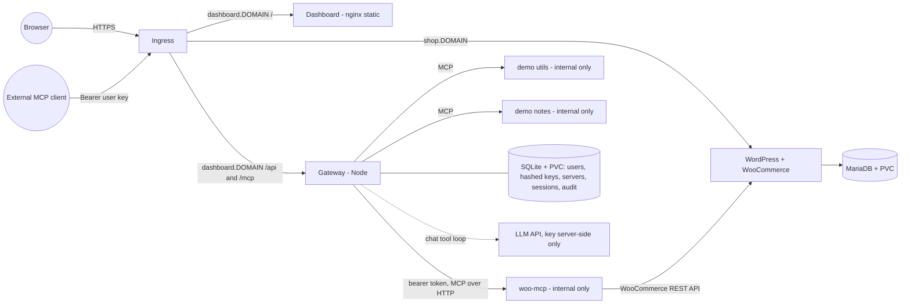

# Urumi MCP platform: WooCommerce + team MCP gateway on Kubernetes

One WooCommerce store, a **custom WooCommerce MCP server**, and a **team MCP gateway** that exposes every registered MCP server through a single endpoint, to humans (React dashboard + chat agent) and to external MCP clients (Claude Code, Cursor, MCP Inspector). Runs on local Kubernetes (kind/k3d) and on a k3s VPS from the same Helm chart.

> **Read this first: what is and is not verified.** Everything in this repo was built and tested in a sandbox that had Node.js but **no Docker, no Kubernetes, no `helm`, and no outbound access to OpenAI/Docker Hub**. Verified: gateway, woo-mcp, demo-mcp, dashboard (109 automated tests), an end-to-end run with real server processes (37 passing checks), and static validation of the Helm chart. **Not verified:** real WooCommerce, a real LLM, `docker build`, `helm install`, any pod running, NetworkPolicy enforcement, TLS. The exact status of every requirement is in [`docs/REQUIREMENTS.md`](docs/REQUIREMENTS.md); the e2e evidence is in [`docs/E2E_LAST_RUN.md`](docs/E2E_LAST_RUN.md).

## Architecture



Nothing but the gateway ever talks to an upstream MCP server. The chat agent runs **inside** the gateway process and calls tools through the same function (`GatewayService.callTool`) as external clients, so policy and audit logging cannot be bypassed by choosing a different entry point.

| Component | Directory | Responsibility |
|---|---|---|
| Gateway + REST API + chat agent | `gateway/` | Auth (keys, sessions), upstream registry, MCP client to every upstream, MCP server endpoint `/mcp`, per-user tool filtering, audit log, chat tool loop |
| WooCommerce MCP server | `woo-mcp/` | 5 tools over MCP Streamable HTTP, backed by the WooCommerce REST API |
| Demo MCP servers | `demo-mcp/` | `utils` (date, calculator) and `notes`: two small self-written upstreams (not third-party) |
| Dashboard | `dashboard/` | React UI: servers, tools, team, keys, audit log, chat |
| Deployment | `charts/urumi/`, `*/Dockerfile`, `scripts/`, `deploy/` | Helm chart (local + prod values), images, cluster scripts |
| Verification | `e2e/`, `charts/tools/`, `*/test/` | Unit/integration tests, end-to-end run, chart checks |

## Quick start A: local Kubernetes (kind)
Needs Docker, kind, kubectl, helm.
```bash
scripts/kind-up.sh          # kind + Calico (NetworkPolicy enforcement) + ingress-nginx
scripts/build-images.sh     # builds gateway, woo-mcp, demo-mcp, dashboard; loads them into kind
scripts/install-local.sh    # helm upgrade --install with values-local.yaml
scripts/smoke.sh            # endpoint + NetworkPolicy isolation checks
```
Local domains: `shop.localtest.me` and `dashboard.localtest.me` resolve to 127.0.0.1 via public DNS (no `/etc/hosts` edit; offline fallback in [`docs/DEPLOYMENT.md`](docs/DEPLOYMENT.md)). First start takes minutes (MariaDB init, WordPress unpack, WooCommerce download). Follow the printed `NOTES.txt` to read the admin API key and WordPress password from the cluster Secret.

## Quick start B: no Kubernetes (development)
Needs Node >= 22.13 only. WooCommerce is not included; use the demo servers or point `woo-mcp` at any WooCommerce.
```bash
make install
export GATEWAY_ENCRYPTION_KEY=$(node -e "console.log(require('crypto').randomBytes(32).toString('base64'))")
export BOOTSTRAP_ADMIN_API_KEY=$(cd gateway && node -e "import('./src/security/apikeys.js').then(m=>console.log(m.generateApiKey().raw))")
echo "$BOOTSTRAP_ADMIN_API_KEY"                                   # you sign in to the dashboard with this
(cd demo-mcp && MODE=utils MCP_AUTH_TOKEN=dev PORT=3010 npm start) &
(cd gateway && DB_PATH=/tmp/gw/gw.db PORT=8080 PUBLIC_ORIGINS=http://localhost:5173 UPSTREAM_ALLOWED_HOSTS=127.0.0.1 npm start) &
(cd dashboard && npm run dev)                                      # http://localhost:5173
# Dashboard > Servers > Add: URL http://127.0.0.1:3010/mcp, Bearer token "dev"
```
Or run the whole scripted flow without any manual setup: `make e2e`.

## How to
**Place an order (local cluster).** The store starts empty. Create a product first (chat: "create a product called Blue Mug priced 199", or wp-admin > Products). Open `http://shop.localtest.me`, add it to the cart, check out with *Cash on delivery*, then sign in at `/wp-admin` (user `shopadmin`, password from the Secret) > WooCommerce > Orders.

**Connect an external MCP client.** Dashboard > API keys > Generate key (shown once). Then use only:
* URL: `http://dashboard.localtest.me/mcp` (prod: `https://dashboard.<domain>/mcp`), transport *Streamable HTTP*
* Header: `Authorization: Bearer <your key>`

MCP Inspector: `npx @modelcontextprotocol/inspector`, choose Streamable HTTP, enter URL and header. Claude Code and Cursor have a "remote HTTP MCP server with custom headers" setting; check their docs for the exact syntax (not verified here). You will see tools named `<server>__<tool>`, e.g. `woo__list_orders`, `utils__current_date`.

**Use the chat agent.** Dashboard > Chat. By default it runs in **mock mode** (scripted; every reply is tagged). For a real model set `gateway.llm.provider=openai`, `gateway.llm.model=<model>` and put `OPENAI_API_KEY` in the Secret (any OpenAI-compatible endpoint works via `OPENAI_BASE_URL`, including a local Ollama).

## Configuration
Gateway settings are environment variables (Kubernetes ConfigMap/Secret in the chart). The important ones:

| Variable | Default | Meaning |
|---|---|---|
| `GATEWAY_ENCRYPTION_KEY` | required | base64 of 32 bytes; encrypts upstream credentials at rest |
| `BOOTSTRAP_ADMIN_API_KEY` | none | first admin's key (`umk_<8>_<43>`); only its hash is stored |
| `PUBLIC_ORIGINS` | required in production | exact dashboard origin(s); CSRF/Origin checks |
| `UPSTREAM_ALLOWED_HOSTS` | empty | exact internal hostnames admins may register (SSRF allowlist) |
| `SESSION_TTL_MINUTES` / `SESSION_IDLE_MINUTES` | 480 / 60 | dashboard session lifetime / inactivity timeout |
| `UPSTREAM_CALL_TIMEOUT_MS` / `UPSTREAM_CONNECT_TIMEOUT_MS` | 30000 / 5000 | per-call and connect timeouts |
| `UPSTREAM_REFRESH_MS` / `UPSTREAM_RETRY_COOLDOWN_MS` | 30000 / 5000 | background tool refresh / fail-fast window for dead upstreams |
| `LLM_PROVIDER` / `LLM_MODEL` / `OPENAI_API_KEY` / `OPENAI_BASE_URL` | mock / none / none / OpenAI | chat agent provider |

Production refuses to start without `PUBLIC_ORIGINS`, a Secure cookie and a valid encryption key.

## Testing
```bash
make test            # gateway 72, woo-mcp 9, demo-mcp 3, dashboard 25 tests
make e2e             # 37 checks against real processes; writes docs/E2E_LAST_RUN.md
make e2e-sabotage    # injects 5 bugs into the gateway; the e2e must fail each time
make chart-verify    # static chart checks (real helm if installed, otherwise a stand-in renderer)
make docs-check      # every path, test citation, code excerpt, env var and number in the docs is checked against the repo
```
`docs/REQUIREMENTS.md` maps every requirement to its implementation file and test.

## Documentation
* [`docs/SYSTEM_DESIGN.md`](docs/SYSTEM_DESIGN.md): architecture choices, tool aggregation/routing/failure handling, production changes
* [`docs/THREAT_MODEL.md`](docs/THREAT_MODEL.md): shared credentials, token passthrough, untrusted upstreams, member-to-member
* [`docs/DEPLOYMENT.md`](docs/DEPLOYMENT.md): local and k3s deployment, values differences, upgrade/rollback
* [`docs/DEMO_SCRIPT.md`](docs/DEMO_SCRIPT.md): the demo video walkthrough, with what is real vs simulated
* [`docs/REQUIREMENTS.md`](docs/REQUIREMENTS.md): requirement to implementation to test checklist, known limitations
* [`docs/INTERVIEW_PREP_HINGLISH.md`](docs/INTERVIEW_PREP_HINGLISH.md): module-by-module Q&A in Hinglish for the walkthrough

## Bonus and stand-out items
| Item | Status | Where |
|---|---|---|
| Tool permissions (per role / per user, hidden + rejected) | Backend, tests, e2e. **No dashboard UI** | `gateway/src/db/database.js` (`tool_rules`), `gateway/src/gateway/service.js`, `/api/policies` |
| Security hardening | SSRF guard, non-root containers, read-only root fs (except documented exceptions), NetworkPolicy deny-by-default, credentials encrypted at rest, no Kubernetes API access for any pod | `gateway/src/security/`, `charts/urumi/templates/` |
| Production-like VPS (k3s) | Chart, `values-prod.yaml`, guide. **Not deployed** | `docs/DEPLOYMENT.md` |
| Upgrades and rollback | Documented with caveats. **Not exercised** | `docs/DEPLOYMENT.md` |
| Multi-store provisioning, OAuth, many-tools search, hosted MCP servers, multiple gateway replicas, metrics | **Not attempted** | n/a |

## Known limitations (short list; full list in `docs/REQUIREMENTS.md`)
Single gateway replica (SQLite on a volume); no rate limit on `/mcp` calls (only login and chat are limited); the OpenAI provider offers the model at most 128 tools; chat has no streaming and no human confirmation before write tools; API keys do not expire (revoke manually); WordPress runs as root with capabilities dropped (documented exception); upgrades of WordPress/gateway cause a short outage (`Recreate`).
