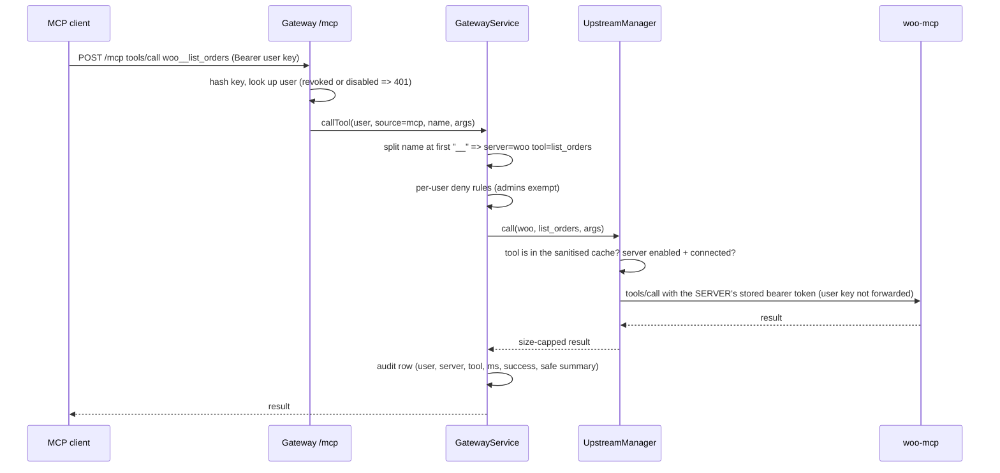

# System design and tradeoffs

## 1. Goals that shaped the design
1. One endpoint for many MCP servers, for people (dashboard, chat) and for tools (Claude Code, Cursor).
2. Admins hold the upstream credentials; members never see them and never need them.
3. A slow, dead or hostile upstream must not break anyone else.
4. Every tool call is attributable to a person.
5. Same Helm chart locally and on a VPS; only values change.

## 2. Components and responsibilities
| Component | Owns | Does not do |
|---|---|---|
| **Gateway** (`gateway/`) | users, hashed keys, sessions, upstream registry + encrypted credentials, MCP client to each upstream, MCP server `/mcp`, per-user tool rules, audit log, chat loop | store data, talk to WooCommerce |
| **woo-mcp** (`woo-mcp/`) | translating 5 MCP tools into WooCommerce REST calls; trimming responses (no customer PII) | authentication of end users (it trusts only the gateway's token) |
| **Dashboard** (`dashboard/`) | UI only; holds no secrets (session cookie is HttpOnly) | any authorization decision (the server enforces everything) |
| **WordPress/WooCommerce + MariaDB** | the store and its data, on persistent volumes | anything MCP |
| **Ingress** | public entry: store host, dashboard host (`/`, `/api`, `/mcp`) | internal services are deliberately not exposed |

## 3. Request flows
### 3.1 An external client calls a tool

### 3.2 The chat agent
`POST /api/chat` (cookie + CSRF, or Bearer) runs a loop in `gateway/src/chat/agent.js`: send the user/assistant history plus the **user's own filtered tool list** to the model; for each returned tool call run `GatewayService.callTool` as that user (`source=chat`); append the result as a `tool` message; repeat until the model answers or limits hit (6 steps, 4 calls per step, 120 s total). Before every tool execution the user's key and account are re-checked, so revoking a key stops an in-flight chat.

## 4. Tool aggregation, routing and naming
* **Naming:** every tool is exposed as `<slug>__<tool>`, always prefixed, even when there is no collision. A "prefix only on collision" scheme would rename existing tools whenever someone adds a server, silently breaking clients and prompts. Server slugs match `^[a-z][a-z0-9-]{1,29}$` so they cannot contain `__`, which makes splitting at the first `__` unambiguous. Slug + `__` + tool name is capped at 64 characters (a common client limit); longer or oddly named upstream tools are skipped.
* **Routing:** the slug picks the upstream; the tool must be in that upstream's sanitised cached list, so tools that failed validation are not callable even by name.
* **Per-user filtering:** deny-rules (`tool_rules`: role=member or a specific user, server, tool or `*`) are applied both when listing and when calling. A denied tool and an unknown tool return the same message. Admins are never restricted, so rules cannot lock out administration.

## 5. Failure handling
| Failure | Behaviour | Why |
|---|---|---|
| Upstream slow | per-call timeout (30 s default) returns a clear tool error; other upstreams unaffected | no head-of-line blocking |
| Upstream dead or hanging | connect timeout (5 s); status becomes `unreachable` with a reason; a 5 s cooldown makes further calls fail fast; background refresh (30 s) reconnects automatically | one dead host must not make every call pay the full timeout |
| Upstream malformed / redirecting | treated as unreachable; redirects are not followed (SSRF) | untrusted input |
| Upstream restarts | stateless upstreams keep working; otherwise the next refresh reconnects | |
| tools/list | served from a cache in memory, never waits on the network | listing must stay instant even when an upstream is down |
| Tool call failure | **never auto-retried** | `create_product` retried after an ambiguous failure could create duplicates |
| Gateway restart | users, keys, sessions, servers and audit survive (SQLite on a volume); tool cache rebuilds within seconds; login/chat rate-limit counters reset | |

Gateway readiness (`/readyz`) checks only the database, never upstreams, so a dead upstream cannot take the gateway out of service.

## 6. Authentication and authorization
* **API keys:** `umk_<8 chars>_<43 chars>`, 256 random bits from the OS CSPRNG, only SHA-256 stored. SHA-256 (not bcrypt) is deliberate: the key is already high-entropy, so brute force is infeasible and a slow hash would only add latency to every MCP request. Up to 10 active keys per user. Shown once at creation.
* **Dashboard login:** paste a key; the server issues a random session token in an `HttpOnly; SameSite=Strict` cookie (`Secure` and `__Host-` prefix in production). Only the token's hash is stored. A session is bound to the key that created it and checked against that key and the user on every request, so revocation and disabling are immediate. Absolute lifetime 8 h, idle timeout 1 h, logout deletes the row.
* **CSRF:** cookie-authenticated writes need an `X-CSRF-Token` (held in JS memory, not storage) and, if the browser sends an `Origin`, it must be an allowed origin. Bearer-key requests are not ambient credentials, so they need no CSRF token. `/mcp` never accepts cookies.
* **Roles:** `admin` and `member`, read from the database on each request. Admin-only routes check the role server-side; members get 403 (and 404 for other people's key ids, to avoid enumeration).
* **`/mcp` is stateless:** a fresh MCP server and transport per HTTP request, authenticated with that request's key. Trade-off: revocation is instant and there is no session map (restart-safe, replica-friendly), but no server-to-client push (`tools/list_changed`) and no GET/SSE stream.

## 7. Data model (SQLite)
`users`, `api_keys` (hash only), `sessions` (token hash, csrf, expiry, key id), `servers` (slug, url, auth type, **encrypted** credential), `tool_rules`, `audit_logs` (user, source `mcp|chat`, server, tool, duration, success, safe summary; **no arguments, no results**).

## 8. Why these choices (tradeoffs)
| Decision | Alternative | Why this | Cost |
|---|---|---|---|
| WooCommerce REST API from woo-mcp | WP-CLI, direct SQL | documented contract; WooCommerce keeps validating and enforcing; no shell or DB access needed by the MCP server | one HTTP hop; REST auth needs HTTPS or a forwarded-proto trick in-cluster |
| SQLite on a volume | Postgres | no extra service, no native build (`node:sqlite`), trivial backup | exactly one gateway replica; no migrations yet |
| Stateless `/mcp` | session-based Streamable HTTP | instant revocation, restart-safe | no push notifications |
| Cached tool lists | list on demand | listing never blocked by a slow upstream | up to 30 s staleness for new upstream tools |
| Chat inside the gateway | separate chat service | identical policy and audit path as external clients | gateway process also holds the LLM client |
| Namespaced tools always | prefix on collision | stable names | longer names |
| Mock chat provider | none | full flow demonstrable without a key | not an LLM; every reply is labelled |

## 9. What changes for production
See [`DEPLOYMENT.md`](DEPLOYMENT.md). In short: your domain and DNS A records for two hosts; Traefik (k3s) instead of ingress-nginx; cert-manager TLS; `local-path` storage (node-local, so back up the volumes); a pre-created Secret (`scripts/create-prod-secrets.sh`) instead of chart-generated secrets; `NODE_ENV=production` (Secure cookie, required origins); a real LLM provider; pinned image digests.

## 10. What I would do next
Postgres for the gateway and a second replica (with a shared rate limiter); a rate limit on `/mcp`; a human-confirmation step before write tools in chat; a tool-search approach for hundreds of tools (today the OpenAI provider offers at most 128); key expiry; metrics (per-server error rate and latency); a UI for tool rules; schema migrations; the multi-store provisioning bonus.
